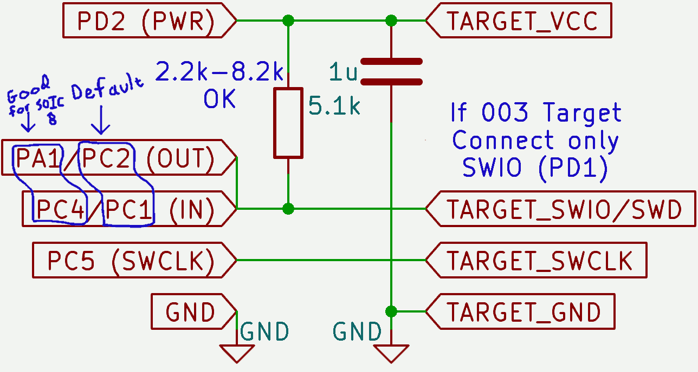

# ch32v003 programmer for WCH RiscV chips

While this is in `master`, it should still be considered somewhat experimental.  It may make sense to instead of use two pins, use two timers on a single pin.

This is still a bit of an RFC and should not be considered the "real path" moving forward.

## A minichlink-compatible programmer

Simply use a CH32V003, connected as follows:

And you can program, semihost and run basic GDB on most of WCH's RiscV chip. Supports both 1 and 2 wire SWD protocols, including old 2-wire SWD found on the first RiscV chips.

Tested as working: CH32V003, CH32V00x, CH32L103, CH32V103, CH32V20x, CH32V30x, CH570/2, CH571/3, CH582/3, CH584/5, CH591/2. CH32X035 is an outlier, it identifies and short commands work, but flashing fails (probably sw USB messes SWD clock).

It's actually only a little slower than the normal programmer somehow, in spite of bit banging USB?

## Generalizing programmer's API

Since October 2026 the common programmer functionality is moved to [ch32fun/minichlink/funprog](../ch32fun/minichlink/funprog/), were it is shared among all platforms *funprog* is ported to. Here is left only hardware specific implementation of low-level functions and configuration files.

To make sure you have the latest version of the programmer, update ch32fun submodule using ``git submodule update --remote``.
