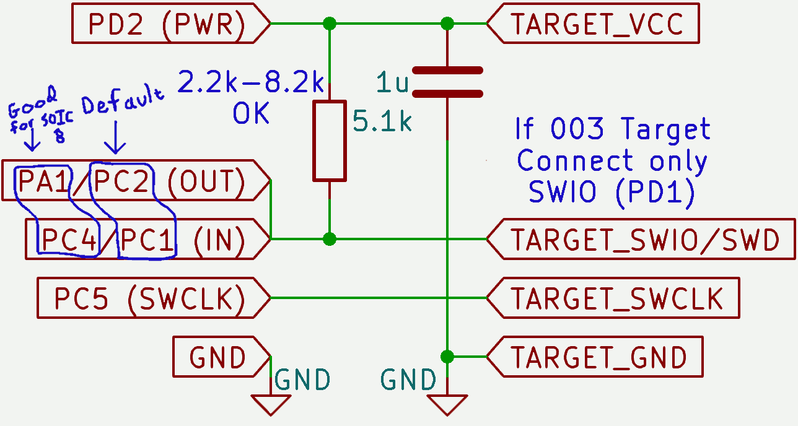

# ch32v003 programmer for WCH RiscV chips

While this is in `master`, it should still be considered somewhat experimental.  It may make sense to instead of use two pins, use two timers on a single pin.

This is still a bit of an RFC and should not be considered the "real path" moving forward.

## A minichlink-compatible programmer

Simply use a CH32V003, connected as follows:

And you can program, semihost and run basic GDB on a variety of WCH chips including the CH32V003, 00x, 20x, 30x, x03x, CH570/2, CH585, CH59x.

Tested and not supported: CH32V103, CH571/3, CH582/3.

It's actually only a little slower than the normal programmer somehow, in spite of bit banging USB?

## Generalizing programmer's API

Since October 2026 the common programmer functionality is moved to [ch32fun/minichlink/funprog](../ch32fun/minichlink/funprog/), were it is shared among all platforms *funprog* is ported to. Here is left only hardware specific implementation of low-level functions and configuration files.

To make sure you have the latest version of the programmer, update ch32fun submodule using ``git submodule update --remote``.
